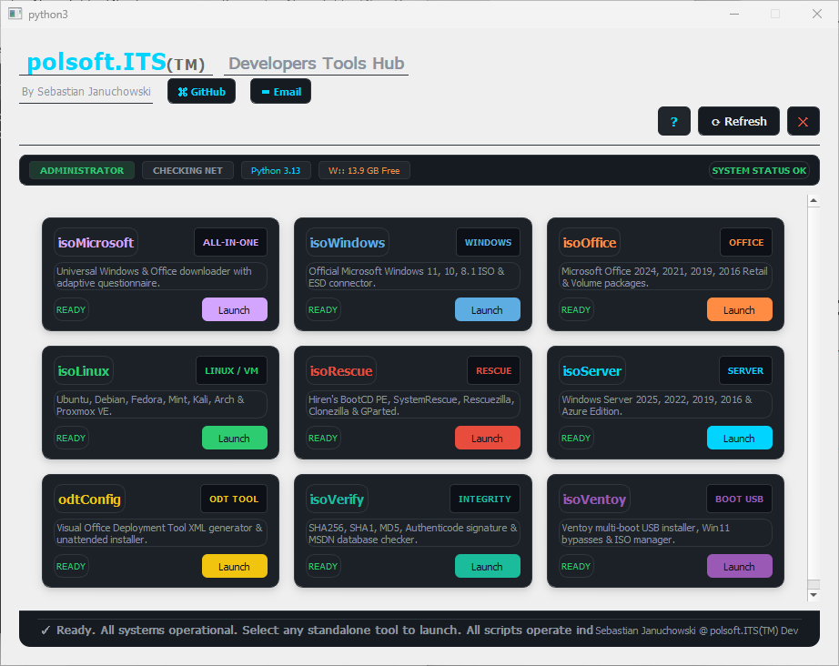

<p align="center">
  
</p>

# polsoft.ITS Developers Tools Hub


**A Windows desktop launcher for nine PowerShell tools** covering Microsoft downloads, Linux and rescue images, Office deployment, ISO integrity, and Ventoy USB management. The launcher is built with Python and PyQt5.

[Polski](docs/readme.pl.md)

## Contents

- [Features](#features)
- [Included tools](#included-tools)
- [Requirements](#requirements)
- [Install and run](#install-and-run)
- [Launcher options and controls](#launcher-options-and-controls)
- [PowerShell tools](#powershell-tools)
- [Project layout](#project-layout)
- [Troubleshooting](#troubleshooting)
- [Safety notes](#safety-notes)
- [Contact](#contact)
- [Licensing](#licensing)

## Features

- Timed splash screen with a direct path to the Tools Hub.
- Dashboard shows whether each PowerShell script is available and launches it in a separate process.
- Network, administrator, and free-disk-space status indicators.
- Refresh the dashboard with the Refresh button or `Ctrl+R`.
- Optional restart as administrator through the Windows UAC prompt.
- Shared PowerShell helpers for logging, disk-space checks, hash verification, and downloads. Downloads use BITS where available and fall back to an HTTP range-capable downloader with progress reporting and resume support.
- About dialog reads the application version from `VERSION`.

## Included tools

| Tool | Script | Purpose |
| --- | --- | --- |
| isoMicrosoft | `scripts/isoMicrosoft.ps1` | Combined Windows and Office download selection. |
| isoWindows | `scripts/isoWindows.ps1` | Windows installation download options. |
| isoOffice | `scripts/isoOffice.ps1` | Office, Project, and Visio product download options. |
| isoLinux | `scripts/isoLinux.ps1` | Linux and Proxmox distribution images, including Ubuntu, Debian, Fedora, Mint, Kali, and Arch. |
| isoRescue | `scripts/isoRescue.ps1` | Rescue and diagnostics images, including Hiren's BootCD PE, SystemRescue, Rescuezilla, Clonezilla, and GParted. |
| isoServer | `scripts/isoServer.ps1` | Windows Server evaluation image options. |
| odtConfig | `scripts/odtConfig.ps1` | Office Deployment Tool configuration XML generator and installer. |
| isoVerify | `scripts/isoVerify.ps1` | File hash, signature, and known-release integrity checks. |
| isoVentoy | `scripts/isoVentoy.ps1` | Ventoy package, USB drive, ISO copy, and configuration management. |

## Requirements

- Windows 10 or later.
- Python 3.9 or later.
- PyQt5.
- Windows PowerShell 5.1 or PowerShell 7 for the PowerShell tools. WPF-based tool windows require Windows.
- An internet connection for online catalogs, downloads, and updates. Administrator rights are required only for operations that need them.

## Install and run

Open PowerShell in the project directory and install the Python GUI dependency:

```powershell
py -m pip install PyQt5
```

Start the launcher:

```powershell
# Show the splash screen, then open the dashboard
py splashScreen.py

# Open the dashboard immediately
py splashScreen.py -SkipSplash

# Show the splash screen only, then exit
py splashScreen.py -SplashOnly -DurationSec 3

# Use a custom splash image
py splashScreen.py -ImagePath "C:\Images\splash.jpg"
```

The default splash image is `splash.jpg` beside `splashScreen.py`. The dashboard expects the `scripts` directory to remain beside the launcher.

## Launcher options and controls

| Option | Description |
| --- | --- |
| `-DurationSec N` | Splash duration in seconds. Default: `3`. |
| `-SplashOnly` | Display the splash screen and exit without opening the dashboard. |
| `-SkipSplash` | Skip the splash screen and open the dashboard directly. |
| `-ImagePath PATH` | Use a custom splash image instead of the default `splash.jpg`. |

On the splash screen, click the window or press `Space` or `Enter` to open the dashboard. Press `Escape` to close the application. In the dashboard, `Ctrl+R` refreshes tool availability. The GitHub button opens the project author's profile; the Email button opens the mail client and copies the address to the clipboard.

## PowerShell tools

The dashboard starts each script with PowerShell. Tools can also be run directly from PowerShell; use each script's help or `-?` to see its supported parameters. For example:

```powershell
# List detected storage drives without changing them
.\scripts\isoVentoy.ps1 -ListDrives

# Verify an ISO against a supplied checksum
.\scripts\isoVerify.ps1 -Path ".\image.iso" -ExpectedHash "<expected-hash>"

# Show the full help for a tool
Get-Help .\scripts\isoVentoy.ps1 -Full
```

All nine scripts import `scripts/isoCommon.psm1` and set TLS 1.2 for their web requests. ISO downloads and Ventoy package downloads are provided by their respective tools; `isoCommon.psm1` supplies shared download and verification helpers.

## Project layout

```text
.
|-- README.md
|-- VERSION
|-- splash.jpg
|-- splashScreen.py
|-- docs/
|   |-- README_PYTHON.md
|   |-- Screenshot.png
|   |-- description.txt
|   |-- readme.pl.md
|   `-- splash_screen_overview.md
`-- scripts/
    |-- isoCommon.psm1
    |-- isoLinux.ps1
    |-- isoMicrosoft.ps1
    |-- isoOffice.ps1
    |-- isoRescue.ps1
    |-- isoServer.ps1
    |-- isoVentoy.ps1
    |-- isoVerify.ps1
    |-- isoWindows.ps1
    `-- odtConfig.ps1
```

## Troubleshooting

- **`No module named PyQt5`:** install the dependency using `py -m pip install PyQt5` with the same Python interpreter used to run the launcher.
- **Qt DLL or platform-plugin errors:** install the Microsoft Visual C++ 2015-2022 Redistributable matching your Python architecture (usually x64). If the Windows platform plugin still fails, reinstall PyQt5 and check that `QT_PLUGIN_PATH` is not pointing to another Qt installation.
- **`py` or `python` is not recognized:** install Python from python.org with the Python Launcher, or run the script with the full path to `python.exe`.
- **A card reports `MISSING`:** restore the expected `.ps1` file and keep the `scripts` folder alongside `splashScreen.py`.
- **A tool exits or a download fails:** check network access and available disk space. Run the script directly from PowerShell to see its output; some tasks may require administrator rights.

## Safety notes

- Verify the selected destination and keep backups before writing files to removable media.
- Ventoy installation can repartition or format the selected USB drive and erase its contents. Confirm the target drive carefully and back up any data before installing Ventoy.
- Windows installation images, Office products, and bypass settings are subject to the applicable Microsoft, vendor, and local licensing or usage terms. Use official sources and verify downloaded files when possible.

## Contact

- GitHub: [polsoft-it](https://github.com/polsoft-it)
- Email: [polsoft.its@mail.com](mailto:polsoft.its@mail.com)
- Author: Sebastian Januchowski @ polsoft.ITS(TM) Dev

## Licensing

There is no repository-wide `LICENSE` file. Check the header and license notice of each tool before redistributing it; individual scripts may have their own licensing terms.
