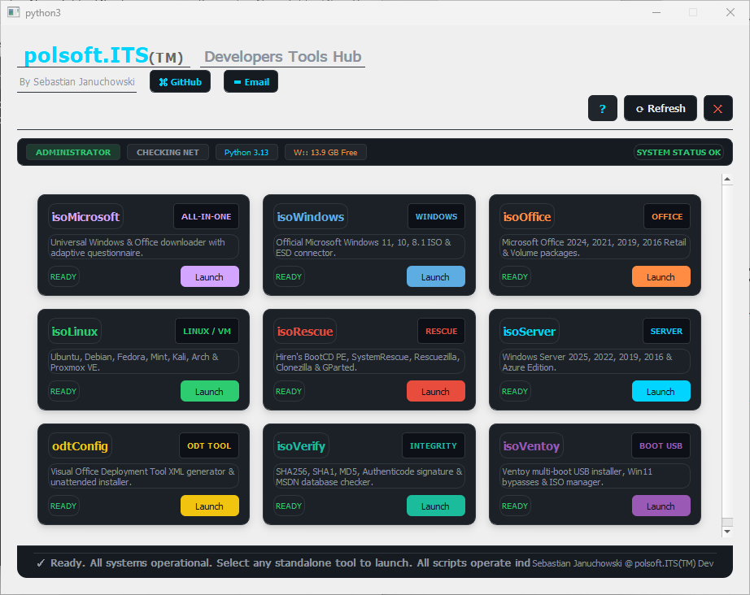

<p align="center">
  
</p>

# polsoft.ITS Developers Tools Hub


**Windowsowy launcher pulpitu dla dziewięciu narzędzi PowerShell** do pobierania obrazów Microsoft, Linux i systemów ratunkowych, konfiguracji Office, weryfikacji ISO oraz obsługi Ventoy. Launcher jest napisany w Pythonie i PyQt5.

[English](../README.md)

## Spis treści

- [Funkcje](#funkcje)
- [Dostępne narzędzia](#dostępne-narzędzia)
- [Wymagania](#wymagania)
- [Instalacja i uruchomienie](#instalacja-i-uruchomienie)
- [Opcje launchera i sterowanie](#opcje-launchera-i-sterowanie)
- [Narzędzia PowerShell](#narzędzia-powershell)
- [Struktura projektu](#struktura-projektu)
- [Rozwiązywanie problemów](#rozwiązywanie-problemów)
- [Uwagi dotyczące bezpieczeństwa](#uwagi-dotyczące-bezpieczeństwa)
- [Kontakt](#kontakt)
- [Licencja](#licencja)

## Funkcje

- Ekran powitalny z odliczaniem i możliwością przejścia bezpośrednio do Tools Hub.
- Dashboard pokazuje dostępność skryptów PowerShell i uruchamia je w osobnych procesach.
- Wskaźniki sieci, uprawnień administratora i wolnego miejsca na dysku.
- Odświeżanie dashboardu przyciskiem Refresh lub skrótem `Ctrl+R`.
- Opcjonalne ponowne uruchomienie z uprawnieniami administratora przez monit UAC systemu Windows.
- Wspólne funkcje PowerShell do logowania, sprawdzania miejsca na dysku, weryfikacji sum i pobierania. Pobieranie używa BITS, jeśli jest dostępny; w przeciwnym razie korzysta z HTTP Range, pokazuje postęp i może wznowić pobieranie.
- Okno About odczytuje wersję aplikacji z pliku `VERSION`.

## Dostępne narzędzia

| Narzędzie | Skrypt | Zastosowanie |
| --- | --- | --- |
| isoMicrosoft | `scripts/isoMicrosoft.ps1` | Wspólny wybór pobierania Windows i Office. |
| isoWindows | `scripts/isoWindows.ps1` | Opcje pobierania obrazów instalacyjnych Windows. |
| isoOffice | `scripts/isoOffice.ps1` | Pobieranie produktów Office, Project i Visio. |
| isoLinux | `scripts/isoLinux.ps1` | Obrazy Linux i Proxmox, m.in. Ubuntu, Debian, Fedora, Mint, Kali i Arch. |
| isoRescue | `scripts/isoRescue.ps1` | Obrazy ratunkowe i diagnostyczne, m.in. Hiren's BootCD PE, SystemRescue, Rescuezilla, Clonezilla i GParted. |
| isoServer | `scripts/isoServer.ps1` | Opcje obrazów ewaluacyjnych Windows Server. |
| odtConfig | `scripts/odtConfig.ps1` | Generator konfiguracji XML Office Deployment Tool i instalator ODT. |
| isoVerify | `scripts/isoVerify.ps1` | Weryfikacja sum plików, podpisów i znanych wydań. |
| isoVentoy | `scripts/isoVentoy.ps1` | Pakiet Ventoy, dyski USB, kopiowanie ISO i konfiguracja. |

## Wymagania

- Windows 10 lub nowszy.
- Python 3.9 lub nowszy.
- PyQt5.
- Windows PowerShell 5.1 lub PowerShell 7 do narzędzi PowerShell. Okna narzędzi oparte na WPF wymagają systemu Windows.
- Dostęp do Internetu dla katalogów online, pobierania i aktualizacji. Uprawnienia administratora są potrzebne tylko do operacji, które ich wymagają.

## Instalacja i uruchomienie

Otwórz PowerShell w katalogu projektu i zainstaluj zależność GUI:

```powershell
py -m pip install PyQt5
```

Uruchom launcher:

```powershell
# Ekran powitalny, a następnie dashboard
py splashScreen.py

# Otwórz dashboard bezpośrednio
py splashScreen.py -SkipSplash

# Pokaż tylko ekran powitalny i zakończ działanie
py splashScreen.py -SplashOnly -DurationSec 3

# Użyj własnego obrazu powitalnego
py splashScreen.py -ImagePath "C:\Images\splash.jpg"
```

Domyślny obraz to `splash.jpg` umieszczony obok `splashScreen.py`. Katalog `scripts` musi znajdować się obok launchera.

## Opcje launchera i sterowanie

| Opcja | Opis |
| --- | --- |
| `-DurationSec N` | Czas wyświetlania ekranu powitalnego w sekundach. Domyślnie: `3`. |
| `-SplashOnly` | Wyświetla ekran powitalny i kończy działanie bez otwierania dashboardu. |
| `-SkipSplash` | Pomija ekran powitalny i od razu otwiera dashboard. |
| `-ImagePath PATH` | Wskazuje własny obraz zamiast domyślnego `splash.jpg`. |

Na ekranie powitalnym kliknij okno albo naciśnij `Spację` lub `Enter`, aby otworzyć dashboard. `Escape` zamyka aplikację. W dashboardzie `Ctrl+R` odświeża dostępność narzędzi. Przycisk GitHub otwiera profil autora, a Email otwiera klienta poczty i kopiuje adres do schowka.

## Narzędzia PowerShell

Dashboard uruchamia każdy skrypt w PowerShell. Skrypty można też uruchamiać bezpośrednio z konsoli; parametry danego narzędzia sprawdzisz przez pomoc skryptu lub `-?`. Przykłady:

```powershell
# Wyświetl wykryte dyski bez wprowadzania zmian
.\scripts\isoVentoy.ps1 -ListDrives

# Zweryfikuj ISO względem podanej sumy kontrolnej
.\scripts\isoVerify.ps1 -Path ".\image.iso" -ExpectedHash "<oczekiwana-suma>"

# Wyświetl pełną pomoc narzędzia
Get-Help .\scripts\isoVentoy.ps1 -Full
```

Wszystkie dziewięć skryptów importuje `scripts/isoCommon.psm1` i ustawia TLS 1.2 dla żądań internetowych. Pobieranie obrazów ISO oraz pakietu Ventoy jest obsługiwane przez odpowiednie narzędzia; `isoCommon.psm1` udostępnia wspólne funkcje pobierania i weryfikacji.

## Struktura projektu

```text
.
|-- README.md
|-- VERSION
|-- splash.jpg
|-- splashScreen.py
|-- docs/
|   |-- README_PYTHON.md
|   |-- Screenshot.png
|   |-- description.txt
|   |-- readme.pl.md
|   `-- splash_screen_overview.md
`-- scripts/
    |-- isoCommon.psm1
    |-- isoLinux.ps1
    |-- isoMicrosoft.ps1
    |-- isoOffice.ps1
    |-- isoRescue.ps1
    |-- isoServer.ps1
    |-- isoVentoy.ps1
    |-- isoVerify.ps1
    |-- isoWindows.ps1
    `-- odtConfig.ps1
```

## Rozwiązywanie problemów

- **`No module named PyQt5`:** zainstaluj zależność poleceniem `py -m pip install PyQt5`, używając tego samego interpretera, którym uruchamiasz launcher.
- **Błędy bibliotek Qt lub wtyczki platformy:** zainstaluj Microsoft Visual C++ 2015-2022 Redistributable zgodny z architekturą Pythona (zwykle x64). Jeśli wtyczka Windows nadal nie startuje, zainstaluj ponownie PyQt5 i sprawdź, czy `QT_PLUGIN_PATH` nie wskazuje innej instalacji Qt.
- **Polecenie `py` lub `python` nie jest rozpoznawane:** zainstaluj Pythona z python.org razem z Python Launcherem albo uruchom skrypt pełną ścieżką do `python.exe`.
- **Karta pokazuje `MISSING`:** przywróć brakujący plik `.ps1` i umieść katalog `scripts` obok `splashScreen.py`.
- **Narzędzie kończy działanie lub pobieranie się nie udaje:** sprawdź sieć i wolne miejsce na dysku. Uruchom skrypt bezpośrednio z PowerShell, aby zobaczyć jego komunikaty; niektóre operacje wymagają uprawnień administratora.

## Uwagi dotyczące bezpieczeństwa

- Przed zapisem danych na nośnikach wymiennych sprawdź cel i wykonaj kopię zapasową.
- Instalacja Ventoy może zmienić partycje lub sformatować wskazany dysk USB i usunąć jego zawartość. Przed instalacją dokładnie sprawdź dysk docelowy i zabezpiecz dane.
- Obrazy instalacyjne Windows, produkty Office i ustawienia omijające wymagania podlegają odpowiednim warunkom licencyjnym Microsoft, dostawców i lokalnych przepisom. Korzystaj z oficjalnych źródeł i w miarę możliwości weryfikuj pobrane pliki.

## Kontakt

- GitHub: [polsoft-it](https://github.com/polsoft-it)
- E-mail: [polsoft.its@mail.com](mailto:polsoft.its@mail.com)
- Autor: Sebastian Januchowski @ polsoft.ITS(TM) Dev

## Licencja

Repozytorium nie zawiera wspólnego pliku `LICENSE`. Przed dalszym rozpowszechnianiem sprawdź nagłówek i informację licencyjną każdego narzędzia; poszczególne skrypty mogą podlegać różnym warunkom.
